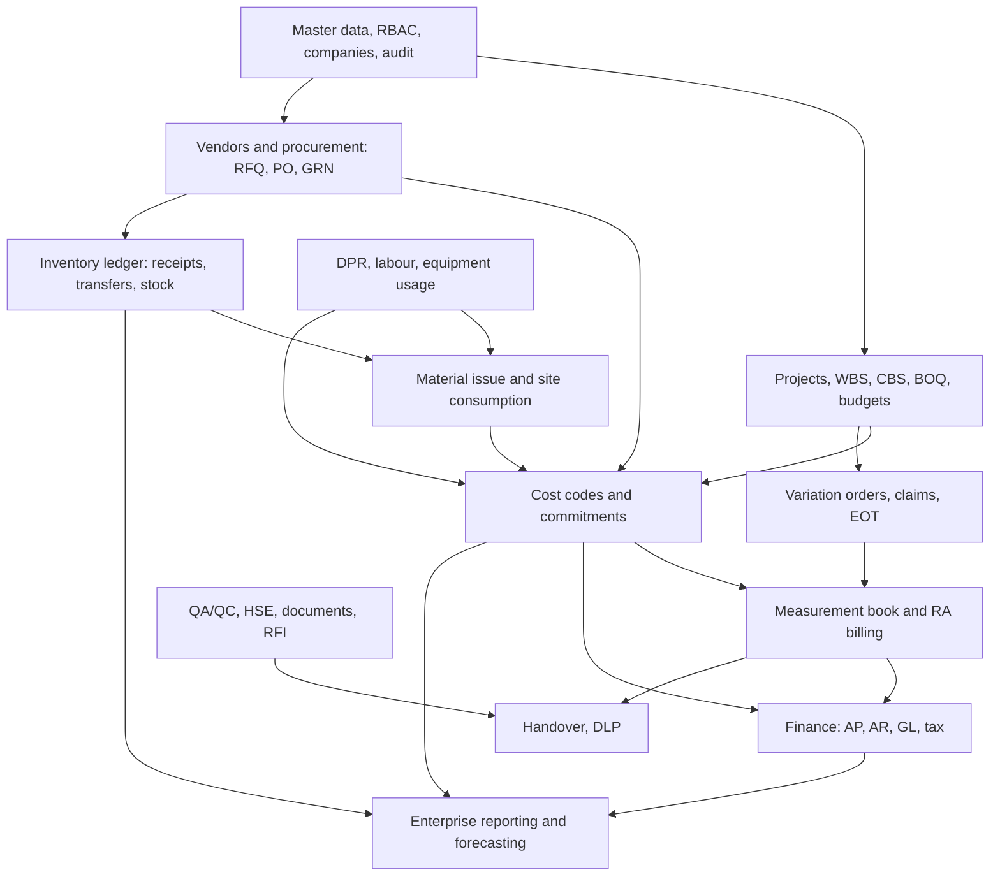

# ZYNO Construction ERP — Enterprise Audit and Completion Register

Audit date: 2026-10-31. Scope: backend (`zyno_construction_backend`) and frontend (`zyno_construction_frontend`) as they exist in the working trees on this date.

This document is the single register for the enterprise completion program. It records what exists, what was verified and how, and what is not yet known. It does not mark anything COMPLETE: no module has passed all eight acceptance gates.

---

## 0. Baseline and recovery point

| Item | Value |
| --- | --- |
| Snapshot folder | `E:\Port\Construction\baselines\2026-10-31-pre-enterprise-audit` |
| Backend HEAD | `f82dab79c9d0eb4af5772d1e6a7434900de4a906` (30 files with uncommitted changes) |
| Frontend HEAD | `548d363ee0dd9d250c8bbe1bd6743f44ddcc2458` (86 files with uncommitted changes, including tracked `dist/` output and deleted `.vscode/` files that predate the inventory work) |
| Snapshot contents | Source trees without `node_modules`, `.git`, `dist`, `.angular` or `.env`; `git diff --binary` patches and status for both repos; copy of the SQLite demo database; copies of the two completion documents; demo scripts (no tokens, no password files) |
| Demo database pre-rotation | `demo3.sqlite` SHA-256 `fd4aebf2d29628a34e680ea258bdd2011173d5d12761d12e05d17ba6f3f93c6c` (copy in `database/` of the snapshot) |
| Demo database post-rotation | SHA-256 `6fee724f19278c40b2b930e16df4bf6edc15d8b899f74361afd7c0be5b74832e` |
| Change made to demo DB | Only the Demo Super Admin password hash in `RBAC_USER` (`gyanprakash@elitemindz.co`). The new password is stored locally, not in this document or in chat. No other rows were changed. |
| Production MySQL | Not connected, not migrated, not modified. |

Correction to earlier notes: both repositories are Git repositories. The earlier statement that they were not under Git was wrong. Both have large uncommitted working trees, so `git status` alone does not describe the baseline. Committing the baseline is a decision for the owner; nothing has been committed in this pass.

Line-ending warnings (CRLF/LF) appear on many tracked files, so the diff statistics overstate real changes. Treat the patch files, not the stat counts, as the record.

### Build and test results at this audit

Recorded in section 0.1 after the runs finished (see the log files in the scratchpad `baseline-*` logs).

---

## 1. Method and limits

What was checked, for every domain:

- Route mounts (`src/routes/routes.js` and module route files), endpoint counts.
- Models (`src/modules/*/models`, 64 files) and table names.
- Migrations (`migrations/`, 13 files) and which tables they create.
- Backend test suites (`tests/`, 23 suites) and frontend sidebar, routes and module folders.
- Keyword search across both trees for capabilities that may be absent.

What was not checked in this pass:

- No browser or runtime exercise of any module except the earlier stock-transfer and inventory walkthrough.
- No deep security review (tenant isolation, IDOR, mass assignment) beyond the existing `security.test.js` and the project-scoped tests for inventory and reallocation.
- Frontend tests: 65 spec files exist, but 43 are generated "should create" stubs and the remainder only assert trivial behaviour. There is no meaningful frontend behavioural test coverage.
- Keyword hits are evidence of presence, not of completeness. A hit in a file list is not a module.

---

## 2. Status definitions

| Status | Meaning |
| --- | --- |
| COMPLETE | All eight acceptance gates passed with evidence. (No module qualifies yet.) |
| IMPLEMENTED | Backend and data model exist with automated tests; frontend, security or integration verification outstanding. |
| PARTIAL | Some functionality exists; named capabilities are missing. |
| BLOCKED | Known defect or dependency prevents progress. |
| NOT STARTED | No implementation found. |

Acceptance gates (from the program brief): 1 Database, 2 Backend, 3 Security, 4 Workflows, 5 Frontend, 6 Integration, 7 Testing, 8 Documentation.

---

## 3. Module register

Overall status is the lowest honest status across the gates. Columns show the evidence found in this pass.

| # | Domain | Overall | Backend | Frontend | Database / migrations | Security | Tests | Integration | Gaps |
| --- | --- | --- | --- | --- | --- | --- | --- | --- | --- |
| 1 | Administration and master data | PARTIAL | Users, companies, RBAC (12 endpoints), categories, material and equipment masters, skill matrix | Users & Team, Roles, Company Profile, Menu Management, master pages | Core tables exist but have **no migration in repo** (see R1) | RBAC middleware on routes; `security.test.js`; `menu_management_enterprise.test.js` | Partial | Auth and RBAC used across modules | No branch or department entities; no generic approval engine (approval logic is per-module) |
| 2 | CRM and sales (leads, enquiries, opportunities, estimates) | NOT STARTED | None for leads, enquiries, opportunities | "Tender Quotations" re-uses procurement quotations with `context=tender` | None | — | None | — | Entire domain; only label reuse exists |
| 3 | Project management and planning | PARTIAL | Projects (27 endpoints), tasks, sub-tasks, dependencies, milestones, teams | Projects portfolio, Work Breakdown Tasks, Gantt Timeline, Calendar | Task and milestone models present; no migration in repo for those | Permission checks on task routes | Not in dedicated suite | Tasks linked to projects | No schedule baseline, resource planning, or forecasting |
| 4 | WBS, CBS, BOQ and budgets | IMPLEMENTED | WBS, CBS, budget, budget heads, allocations, lines, commitment ledger, cost ledger, BOQ routes (7), budget routes (16) | Project budget widget, budget reconciliation | Migrations `20261014000005`, `…006`, `…007`, `…009` | Via project routes | `budget_heads`, `budget_wbs`, `budget_reconciliation_fix`, `commitment_reconciliation`, `project_cost_ledger` | Commitments and cost ledger linked to budget | BOQ to material/cost-code link not verified; forecast at completion not found; frontend not browser-verified |
| 5 | Procurement and vendor management | PARTIAL | Vendors (20 endpoints), quotations/RFQ (14), PO and GRN models, vendor invoices, payment requests, labour vendors | Vendor directory, quotations, new RFQ, procurement contracts, invoices and liabilities | PO/GRN in `20261014000004`; payment reference unique in `…008` | Vendor audit history | `procurement.test.js`, `cumulative_matching.test.js` | GRN into inventory via GRN model | **No purchase request (PR) entity** (0 hits); three-way match scope not verified |
| 6 | Inventory and warehouse | IMPLEMENTED (core) | Stock ledger, store locations, same-project transfers, in-transit, approvals, reconciliation endpoint, inventory API | Inventory page, stock transfer register, detail, in-transit board, approvals | Migrations `20261014000003`, `20261029000001`, `20261030000001` | Super Admin override with audit; SoD tests; RBAC | `inventory_ledger`, `inventory_assignment`, `inventory_demo`, `stock_transfer*` (3 files) | Feeds project stock and reconciliation | Reservations, picking, warehouse-level returns not found; approval queue and in-transit board browser verification pending; **cross-project reallocation BLOCKED** |
| 7 | Material management (project stock, issue, consumption) | PARTIAL | Material routes (7), history (4), project stock with UOM policy, issues and receipts | Materials page with Review Required for reallocation | `material_project_stock` UOM migration `20261030000001` | Reallocation gate 409 with auth preserved | `project_reallocation_gate.test.js` | Stock to project counters | Fractional UOM refused (`PRECISION_UNSUPPORTED`); consumption to WBS/BOQ cost code not verified |
| 8 | Construction execution and site operations | PARTIAL | DPR (2 routes, work items), labour attendance (2), snags (6), drawings (4) | DPR and snags via project context | DPR and labour models; no migration in repo | Permission checks | Snag and copilot tests only | DPR links to project | No productivity measurement, no site instruction workflow found |
| 9 | Equipment and fleet | PARTIAL | Equipment master, project stock, reassignment, history (equipment routes: 8 endpoints) | Equipment Fleet, Equipment Master, Machinery Transfers, equipment history | Equipment models; no migration in repo | Permission checks | `project_reallocation.test.js` (equipment cases) | Equipment to project stock | **Maintenance, fuel and rental not found** (0 hits) |
| 10 | Workforce and labour | PARTIAL | Labour attendance (2), labour vendors (6), skill matrix, timesheet (1 hit) | Site Labour Attendance, Skill Matrix | Labour attendance model | Permission checks | None dedicated | Labour to project | **Payroll not implemented**: sidebar group "H.R & Payroll" leads to no payroll screen (only label text in `site-labour-attendance.html`); timesheets not found |
| 11 | QA/QC | PARTIAL | Snags and defects only; GRN has inspection fields | Snags page | — | — | Snag tests | Snags to project | **No ITP, inspection workflow, test plans or NCR** |
| 12 | HSE | NOT STARTED | None (0 hits for incident/HSE) | None dedicated | None | — | None | — | Entire domain (incidents, permits, PPE, safety inspections) |
| 13 | Document management | PARTIAL | Drawing register (4), documents model, meeting minutes with mail service | Drawings & Blueprints | Drawing register; no migration in repo | Protected file serving (`/api/v1/files`) | None dedicated | Mail service | **No RFI, submittal or transmittal workflow**; correspondence not found |
| 14 | Measurement Book and commercial billing | IMPLEMENTED | Measurement books (8 routes, items), contractor RA bills (4), billing service with GST/TDS | Measurement and RA bill UI within project context | Migration `20261014000010` | Permission checks | `measurement_billing.test.js`, `cumulative_matching.test.js` | Billing to budget and commitments | Client RA billing and certification flow not verified |
| 15 | Subcontractor management | PARTIAL | Subcontractor references in vendors, contractor RA bills (7 hits) | Vendor and contract screens | — | — | Billing tests | Billing | Registration, agreements, work orders not verified; treat as partial |
| 16 | Change orders, claims and EOT | PARTIAL | Variation orders (12 endpoints), items, variation service | Variation UI within project | Migration `20261014000011` | Permission checks | `variation_orders.test.js` | Variations to budget | **EOT not found**; claims limited to variation references |
| 17 | Finance and accounting | PARTIAL | Cost ledger, commitment ledger, vendor payment requests, invoices and liabilities, GST and TDS fields | Invoices & Liabilities, budget reconciliation | Ledgers in migrations `…006`, `…009` | Permission checks | Commitment and cost ledger tests | Commitments and cost ledger | **No general ledger, accounts receivable, payroll or statutory reporting** |
| 18 | Handover, commissioning and DLP | NOT STARTED | None (0 hits for DLP, warranty, commissioning) | None | None | — | None | — | Entire domain; defects exist only as snags |
| 19 | Reporting and analytics | PARTIAL | Dashboard routes, export routes, copilot (AI) routes | Dashboard, executive dashboard label, budget widgets | — | Permission checks | Copilot snag test | Reads all modules | No forecast at completion, no project health or report builder |
| 20 | Notifications and workflow automation | PARTIAL | Mail service (nodemailer) used by meetings and drawings; approvals per module | Stock approvals queue | — | — | Stock override tests | — | **No notification module or generic workflow engine** |

Platform audit trail: history models exist for projects, materials, equipment, vendors and quotations (`*_history`). Coverage per module is not verified.

Overall count: 0 COMPLETE, 3 IMPLEMENTED (domains 4, 6 and 14), 14 PARTIAL, 3 NOT STARTED (domains 2, 12 and 18). Domain 6 carries a BLOCKED sub-item (section 3.1).

### 3.1 Blocked items

| Item | Status | Reason |
| --- | --- | --- |
| Cross-project material reallocation | BLOCKED (safe) | Server returns 409 before any database access; ledger-based replacement not built |
| MySQL verification | BLOCKED | No approved isolated MySQL environment; SQLite results must not be reported as MySQL results |
| Production Super Admin identity | BLOCKED | Not queried; demo identity is a local copy only |
| Demo Super Admin credential | Rotated | Old credential was shared in chat; new value stored only locally |

---

## 4. Dependency map

Reading the map:

- Everything commercial depends on the cost structure in row 4 (WBS/CBS/BOQ/budgets/commitments). This is the strongest existing foundation.
- Inventory depends on procurement (GRN) and feeds project stock, consumption and cost. The unfinished piece is the cross-project reallocation, which touches stock counters and the ledger.
- Finance, handover and reporting depend on the layers above. None of the finance ledgers (GL, AR) exists yet.
- Quality, HSE and documents do not block the core cost chain, but they block handover.

---

## 5. Blockers and technical risks

| ID | Risk | Severity | Evidence | Mitigation |
| --- | --- | --- | --- | --- |
| R1 | **Schema is not reproducible from the repository.** Only 19 tables are created by the 13 migrations (budgets, WBS/CBS, commitments, cost ledger, measurement books, RA bills, variation orders, stock transfers, store locations, UOM). Core tables (company, user, project, material, equipment, vendor, PO, GRN, quotation, DPR, labour) have no migration. | High | `createTable` scan of `migrations/` | Produce a schema baseline from the demo database, then add a baseline migration. Required before any MySQL verification. |
| R2 | **Schema-alter scripts** `scripts/sync-models.js` and `scripts/sync-procurement.js` call `sync({ alter: true })` on named models. Pointed at production this is an unreviewed schema change. | High | Script contents | Do not run against any shared database. Replace with reviewed migrations or gate behind the migration target guard. |
| R3 | MySQL behaviour is unverified: race conditions (checkout oversell) were only tested sequentially on SQLite. | High | Earlier concurrency notes | Obtain an isolated MySQL environment; run concurrency tests there. |
| R4 | No frontend behavioural tests. 43 of 65 specs are generated stubs. | Medium | Spec scan | Add component and service tests for workflow screens; browser acceptance per batch. |
| R5 | Large uncommitted working trees in both repos; frontend `dist/` is tracked in Git; `.vscode/` deleted. | Medium | `git status` | Owner decision: commit a baseline; stop tracking `dist/`. |
| R6 | Navigation shows groups with no screens (H.R & Payroll, Finance & Accounts sub-items). | Medium | Sidebar entries | Hide or mark not-available until implemented. |
| R7 | Reallocation counters (`stockUsed`) are mutated without ledger rows in the blocked legacy path. The gate stops new writes; existing data is not corrected. | High (contained) | Earlier root-cause analysis | Ledger replacement with paired movements and independent reconciliation (next batch). |
| R8 | Browser verification outstanding for the approval queue, in-transit board, project selection persistence and Back navigation. | Medium | Earlier verification notes | Browser pass on the current build before declaring the inventory demo complete. |
| R9 | Demo Super Admin credential was shared in chat. | Low (rotated) | Chat history | Rotated on 2026-10-31. The chat transcript still contains the old value; do not reuse it. |
| R10 | No deep security review across modules (tenant isolation, mass assignment, IDOR) beyond targeted tests. | High | Method limits | Security gate per module during each wave. |

---

## 6. Roadmap

Three milestones, eight waves. Each wave must pass all eight gates before it is marked complete.

| Milestone | Waves | Exit criteria |
| --- | --- | --- |
| A — Operational ERP | 0 (baseline and schema), 1 (foundation), 2 (project controls), 3 (procurement, inventory, warehouse), 4 (site execution) | Cost chain connected from procurement to site consumption; reallocation replaced; schema reproducible; MySQL verified |
| B — Commercial ERP | Commercial part of 6, plus subcontractor billing, EOT, client RA billing, commitments and finance | Billing and commitments reconciled to the cost ledger; tax configuration reviewed |
| C — Enterprise ERP | 5 (QA/QC, HSE, documents), 7 (GL, AP, AR, payroll), 8 (reporting, notifications, handover, hardening) | Handover workflow, statutory reporting, production readiness review |

Wave list (from the program brief) with current state:

| Wave | Content | Current state |
| --- | --- | --- |
| 0 | Baseline snapshot, schema baseline, audit | Snapshot and this audit done; schema baseline not done (R1) |
| 1 | Platform foundation and master data | PARTIAL: branches, departments, approval engine missing |
| 2 | Project planning and project controls | IMPLEMENTED for WBS/CBS/budget/commitments; schedule baseline and forecasting missing |
| 3 | Procurement, inventory and warehouse | Inventory core IMPLEMENTED; PR missing; reallocation BLOCKED; reservations and picking missing |
| 4 | Construction execution and site operations | PARTIAL; productivity missing |
| 5 | Quality, safety, documents | PARTIAL (snags and drawings only); NCR, ITP, HSE, RFI, submittals missing |
| 6 | Commercial and contract management | IMPLEMENTED for MB and RA bills; variations implemented; EOT and claims missing |
| 7 | Finance, accounts and workforce | PARTIAL; GL, AR, payroll missing |
| 8 | Enterprise reporting and production readiness | PARTIAL; handover, DLP and notifications missing; production readiness not started |

---

## 7. Recommended next batch

The brief proposed: reallocation ledger integration, warehouse management and project cost controls. The dependency analysis supports the order below. Stage 0 items (R1, R2) must be handled first because every later batch depends on a reproducible schema and a safe database target.

### Batch 0 — Schema and safety (before any feature work)

1. Produce a schema dump of the isolated demo database and compare it with the 64 models to list every table lacking a migration.
2. Add a baseline migration (or a reviewed set) for the core tables, tested for up and down on SQLite and reviewed for MySQL. Do not run it against production.
3. Disable `scripts/sync-models.js` and `scripts/sync-procurement.js` for any shared target, or document them as demo-only.
4. Owner decision: commit the two baselines (backend and frontend) so the recovery point lives in Git history.

### Batch 1 — Reallocation ledger replacement (milestone A, step 1)

Design (proposed, not implemented):

- One transaction per request, with two paired ledger rows: `reallocation_out` on the source project and `reallocation_in` on the destination, sharing one `transfer_id` and one idempotency key scoped per company.
- Validation before any write: same company for both projects, same material and UOM, source placed or unplaced quantity sufficient, quantity a positive integer.
- Stock counters updated only by the ledger, never directly. Legacy `stockUsed` writes removed from the path.
- Independent reconciliation: per-project balance equals the ledger sum; company-wide total unchanged by reallocation.
- Tests: concurrency on MySQL (blocked until an isolated MySQL exists), idempotent retry, rollback on failure, company isolation, reconciliation.
- The 409 gate stays in place until these tests pass. Only then is the endpoint re-enabled.

### Batch 2 — Warehouse management

Reservations, picking and issue against reservations, returns and damaged stock, inter-store movements. Builds on the existing store locations and in-transit model.

### Batch 3 — Material-to-project cost and project controls

Link material issue and consumption to WBS and BOQ cost codes, post to the cost ledger, and show budget versus actual versus commitments.

### Batch 4 — Cost reporting

Budget versus actual, committed cost, variance and forecast at completion. This is the first point where reporting can be trusted, because the cost chain is complete.

Decisions needed from the owner before Batch 1 starts:

1. Approve Batch 0 and the commit of the two baselines.
2. Confirm whether an isolated MySQL instance will be provided for concurrency verification.
3. Confirm the reallocation design above (paired `reallocation_out` / `reallocation_in` rows).

---

## 8. Verification register (corrected)

| Area | Actual status |
| --- | --- |
| Backend regression | Result recorded in section 0.1 |
| Production build | Result recorded in section 0.1 |
| Inventory and transfers | API verified; earlier UI workflows verified |
| Approval queue | API verified; browser verification pending |
| In-transit board | API verified; browser verification pending |
| Project selection and Back navigation | Code present; browser verification pending |
| Cross-project material reallocation | BLOCKED (safe) |
| Production Super Admin identity | BLOCKED |
| Production MySQL | Not verified; not modified |
| Demo Super Admin credential | Rotated 2026-10-31 |

### 0.1 Results recorded at this audit

Filled in after the test and build runs complete.
